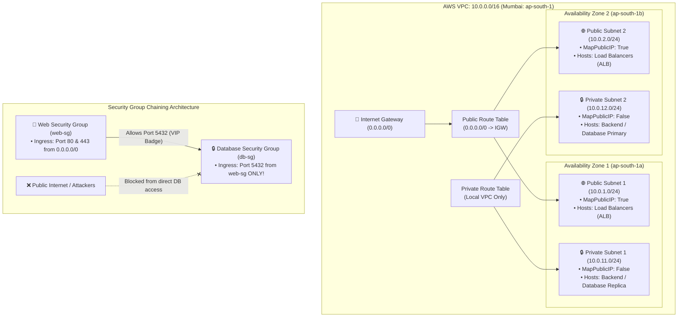

# Production-Grade Multi-AZ AWS VPC & Security Architecture


A modular, enterprise-grade Infrastructure as Code (IaC) repository provisioned with **Terraform** on **Amazon Web Services (AWS)**. 

Designed for **High Availability (HA)** across two Availability Zones (`ap-south-1a` and `ap-south-1b`), implementing a strict two-tier Public/Private subnet topology, cryptographic **Security Group Chaining**, and modern **S3 Remote State Storage with Native State Locking**.

---

## 🧭 Architectural Topology



---

## 🎯 Key Architectural Pillars

### 1. High Availability (Multi-AZ)
* Redundancy across two physically isolated AWS data centers (`ap-south-1a` and `ap-south-1b`) ensures resilience against single-facility power or network failures.
* Minimum standard required by AWS Application Load Balancers (ALBs) and Multi-AZ Amazon RDS failover groups.

### 2. Strict Subnet Isolation
* **Public Tier (`10.0.1.0/24`, `10.0.2.0/24`):** Associated with an Internet Gateway (`IGW`) route for public-facing ingress.
* **Private Tier (`10.0.11.0/24`, `10.0.12.0/24`):** Completely decoupled from the IGW. Databases and internal compute run in total network isolation.

### 3. Cryptographic Security Group Chaining
* Eliminates brittle, hardcoded IP whitelisting in firewalls.
* Database Security Group (`db_sg`) strictly permits incoming TCP on port `5432` originating **only** from network interfaces associated with `web_sg` (`security_groups = [aws_security_group.web_sg.id]`).

### 4. Production Remote Backend (S3 + Native Lockfile)
* Remote state storage hosted in an Amazon S3 bucket with **S3 Versioning** (snapshot rollbacks) and **AES-256 server-side encryption**.
* Uses modern Terraform v1.10+ native S3 conditional write locking (`use_lockfile = true`), completely eliminating team race conditions and state corruption.

---

## 📁 Repository Structure

```text
├── providers.tf            # Terraform & AWS provider definitions, S3 backend configuration, and default tags
├── variables.tf            # Parameterized input variables (CIDRs, region, project tags)
├── terraform.tfvars.example # Example variable values for staging and production deployments
├── vpc.tf                  # Declarative VPC, Subnets (count loops), IGW, and Route Tables
├── security.tf             # Web and Database Security Groups with chained ingress rules
├── outputs.tf              # Exported attributes (VPC ID, Subnet IDs, Security Group IDs)
└── .gitignore              # Ignores local state, backups, and provider cache
```

---

## 🚀 Quickstart & Deployment

### Prerequisites
* [AWS CLI v2](https://aws.amazon.com/cli/) configured with appropriate IAM credentials.
* [Terraform v1.5+](https://developer.hashicorp.com/terraform/downloads).

### 1. Initialize & Download Providers
```bash
terraform init
```

### 2. Preview Execution Plan
```bash
terraform plan
```

### 3. Deploy to AWS
```bash
terraform apply
```

### 4. Inspect Outputs
```bash
terraform output vpc_id
terraform output public_subnet_ids
terraform output private_subnet_ids
```

### 5. Clean Teardown
```bash
terraform destroy
```

---

## 👨‍💻 Author
**Aryan**  
* GitHub: [@Fluffy-The-Penguin](https://github.com/Fluffy-The-Penguin)
